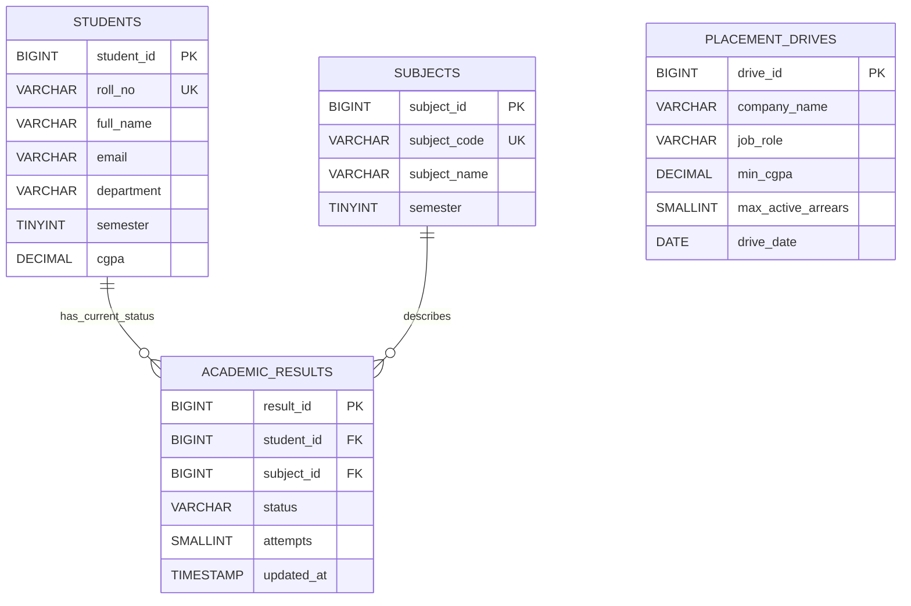

# ArrearTrack design notes

## Entity relationship model



A drive's rule row is evaluated against each student's profile/result rows. There is no stored many-to-many eligibility snapshot; eligibility is recalculated from current data when requested.

## Class relationships

```text
Person (abstract)
  └── Student

EligibilityRule (interface)
  └── StandardEligibilityRule

EligibilityService ── uses ──> EligibilityRule
MainFrame ── uses ──> StudentRepository / AcademicResultRepository / PlacementDriveRepository
JdbcRepositories ── implements repository contracts using JDBC
MainFrame ── uses ──> EligibilityAnalytics / EligibilityCsvExporter
```

| Class / interface | Responsibility |
|---|---|
| `Person` | Common identity state and role contract |
| `Student` | Roll number, department, semester, optional CGPA; validates academic values |
| `Subject` | Subject code, name, semester |
| `AcademicResult` | Current status, attempt count, student/subject references |
| `PlacementDrive` | Company, role, optional minimum CGPA, arrear cap, optional date |
| `EligibilityResult` | One decision, active-arrear count, and unmet-rule messages |
| Repository interfaces | Persistence contracts that keep UI/domain independent from SQL |
| `JdbcRepositories` | JDBC CRUD and SELECT statements with prepared parameters |
| `EligibilityService` | Counts active arrears and evaluates each student using the supplied strategy |
| `StandardEligibilityRule` | Applies the configured CGPA and arrear conditions |
| `EligibilityAnalytics` | Uses reductions and parallel stream collectors to summarize overall and department-level outcomes |
| `EligibilityCsvExporter` | Exports current eligibility results as UTF-8 CSV using byte/character streams and an `Iterator` |
| `MainFrame` | Swing tabs, forms, tables, and user actions |

## Table dictionary

### `students`
- `student_id`: auto-increment primary key.
- `roll_no`: required and unique local identifier.
- `full_name`, `email`, `department`: required profile text.
- `semester`: 1–8.
- `cgpa`: nullable; when present 0–10.

### `subjects`
- `subject_id`: auto-increment primary key.
- `subject_code`: required unique subject identifier.
- `subject_name`: required label.
- `semester`: 1–8.

### `academic_results`
- `result_id`: auto-increment primary key.
- `student_id`, `subject_id`: foreign keys.
- `status`: exactly `PASS` or `ARREAR`.
- `attempts`: count, minimum 1.
- Unique `(student_id, subject_id)`: each pair has one current known status.
- `updated_at`: changes when current result is modified.

### `placement_drives`
- `drive_id`: auto-increment primary key.
- `company_name`, `job_role`: required.
- `min_cgpa`: optional 0–10 criterion.
- `max_active_arrears`: maximum allowed, with inclusive comparison.
- `drive_date`: optional demonstration date.

## Data integrity and SQL safety

Foreign keys stop results from pointing to absent students or subjects. Deleting a student cascades its result rows; subject deletion is restricted while referenced. Unique keys prevent duplicate roll numbers, subject codes, and current result pairs. Java-side constructors validate values; database `CHECK` constraints provide a second layer. JDBC queries use prepared statements. DB credentials are read from environment variables and must never be committed to source control.
