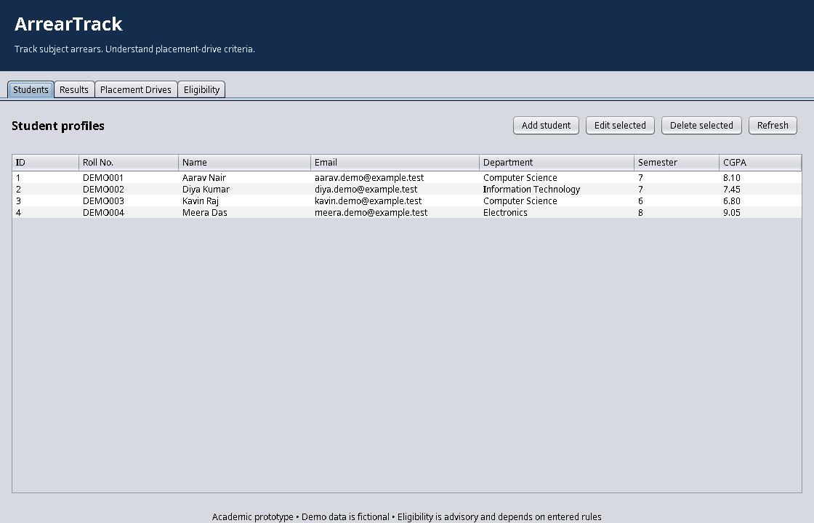
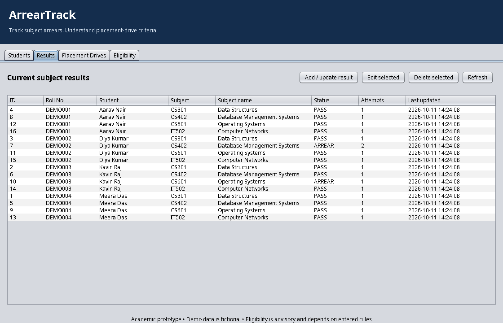
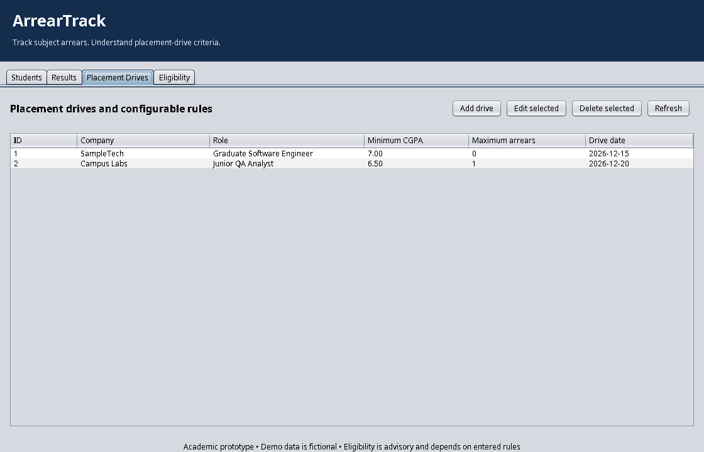
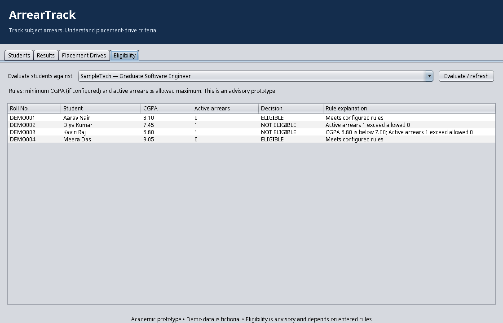

# ArrearTrack — College Arrear and Placement Eligibility Tracker

## Project report (draft for team completion)

**Institution:** [College name]  
**Department / programme:** [Department, course, year/semester]  
**Submitted to:** [Faculty guide / course instructor]  
**Submitted by:** [Team member names and register numbers — maximum 4]  
**Academic year:** [Academic year]  
**Project version:** 1.0 prototype

> Replace every square-bracket placeholder. Confirm the final title and required report template with the instructor. Do not add real student records or claim official college integration.

## Abstract

ArrearTrack is a Java Swing desktop prototype for recording student profiles, current subject-result status, and configurable placement-drive rules. It demonstrates object-oriented programming, relational database design, JDBC connectivity, and create/read/update/delete (CRUD) operations. The system counts a student's saved `ARREAR` result rows and compares that count and (when configured) CGPA against a selected drive's thresholds. It reports a decision and the specific unmet rules. MySQL stores the data; the supplied demonstration rows are fictional. ArrearTrack is advisory and is not an official placement decision system.

## 1. Introduction and problem statement

Students can carry failed subjects as arrears while campus placement drives can impose eligibility rules such as minimum CGPA and restrictions on active arrears. If these details are maintained separately or are hard to interpret, a student may not have a simple view of their current position against a particular drive. ArrearTrack provides one small local application to record current result status, maintain drive-specific thresholds, and show which entered conditions a profile does or does not meet.

This topic was selected after the student confirmed that arrears can affect placement eligibility at their college. A supplied Tamil Nadu student-problems research report also discusses this issue and cites an Anna University survey and special-examination response. Any statistic from that report must be checked against its original cited article before being quoted in a submitted report; this prototype does not claim that any reported percentage applies to this college.

## 2. Aim and objectives

**Aim:** Build a small Java/MySQL application that demonstrates how current arrear records can be checked against configurable placement-drive criteria.

**Objectives:**
1. Store and maintain student profiles using validated forms.
2. Store each student's latest known PASS/ARREAR result by subject and track the attempt count.
3. Let an operator maintain placement drives with an optional minimum CGPA and a maximum active-arrear count.
4. Evaluate student records against a selected drive and show unmet criteria in plain language.
5. Demonstrate OOP concepts, JDBC database connectivity, relational keys/constraints, and CRUD.

## 3. Scope, users, and assumptions

**Prototype users:** student-project demonstrator / placement-coordinator role (no authentication is implemented). The UI is local desktop software.

**In scope:** student CRUD; result CRUD; drive/rule CRUD; rule evaluation; validation; MySQL persistence; fictional sample data.

**Out of scope:** official college portal connection, recruitment/offer decisions, authentication or role permissions, messaging, notifications, student-data imports, dashboards with institutional statistics, and historical exam-attempt audit trails.

**Assumptions:** each student-subject row holds the current known status; an `ARREAR` row counts as one active arrear; a `PASS` row does not. An omitted CGPA threshold means that criterion is not used. A missing CGPA fails a drive that does specify a threshold. The maximum-arrears rule is inclusive (`count <= configured maximum`). The configured values are examples only and must be verified against the actual drive notice before real use.

## 4. Functional and non-functional requirements

### Functional requirements
- **FR1:** Add, list, edit, and delete student profiles.
- **FR2:** Add/update and list current results for a student and subject; delete a current result row.
- **FR3:** Add, list, edit, and delete placement drives and their eligibility thresholds.
- **FR4:** Count active arrears from current `ARREAR` result rows.
- **FR5:** Evaluate all saved students for a selected drive and show eligible/not eligible plus unmet reasons.
- **FR6:** Validate required fields, semester (1–8), CGPA (0–10), non-negative arrear cap, and supported result status (`PASS` or `ARREAR`).
- **FR7:** Persist data in MySQL through JDBC and preserve referential integrity.

### Non-functional requirements
- **NFR1:** Use a layered UI / service / repository design.
- **NFR2:** Use prepared SQL statements and read connection credentials from environment variables.
- **NFR3:** Keep the app usable as a small desktop demonstration with readable messages and tables.
- **NFR4:** Use synthetic examples by default; avoid storing unnecessary personal information.
- **NFR5:** Make rules explicit and outcomes explainable.

## 5. System design

### Modules
1. **Presentation:** Java Swing tabs — Students, Results, Placement Drives, Eligibility.
2. **Domain:** `Person`, `Student`, `Subject`, `AcademicResult`, `PlacementDrive`, `EligibilityResult`.
3. **Service:** `EligibilityService` and `EligibilityRule` / `StandardEligibilityRule`.
4. **Persistence:** repository interfaces and JDBC implementations in `JdbcRepositories`.
5. **Database:** MySQL tables defined in `database/schema.sql`.

### OOP concepts demonstrated
- **Encapsulation:** domain fields are private/final and checked in constructors; validated getters expose read-only state.
- **Inheritance:** `Student` extends abstract `Person` and inherits ID, name, email, and the abstract role contract.
- **Abstraction:** repository interfaces specify data operations without exposing SQL to the UI. The `EligibilityRule` interface specifies the eligibility operation.
- **Polymorphism:** `EligibilityService` accepts an `EligibilityRule` and calls `evaluate`; a different rule implementation can be substituted without changing the service's use.
- **Composition:** the application composes repositories and an eligibility service in its main window.

### Eligibility logic
For each student and selected drive:
1. Count the student's rows with status `ARREAR`.
2. If `min_cgpa` is configured, fail if CGPA is missing or below the threshold.
3. Fail if active arrears exceed `max_active_arrears`.
4. Show **ELIGIBLE** only when no configured rule fails; otherwise list each reason.

## 6. Database design

The design uses four related tables. `students` and `subjects` are master data; `academic_results` links the two with a unique student-subject pair; `placement_drives` stores the drive's company, role, and rule thresholds. Primary keys identify rows, foreign keys link results to students and subjects, `UNIQUE` prevents duplicate current-result pairs, and `CHECK` constraints enforce key ranges. This avoids repeating names and subject details in every result row.

| Table | Purpose | Important columns / constraints |
|---|---|---|
| `students` | Student profile | PK `student_id`; unique `roll_no`; semester 1–8; optional CGPA 0–10 |
| `subjects` | Subject catalogue | PK `subject_id`; unique `subject_code`; semester 1–8 |
| `academic_results` | Latest known student-subject result | PK `result_id`; FKs to student and subject; unique `(student_id, subject_id)`; `PASS`/`ARREAR`; attempts ≥ 1 |
| `placement_drives` | Drive plus criteria | PK `drive_id`; optional min CGPA; non-negative maximum active arrears; optional date |

**Relationship summary:** one student has many current result rows; one subject has many current result rows; each current result belongs to exactly one student and one subject. Placement-drive rules are evaluated against students and are not stored as student-specific copies.

Full executable DDL and fictional seed data are in `database/schema.sql`; the diagram and field notes are in `docs/DESIGN.md`.

## 7. Implementation and run instructions

**Stack:** Java 21, Swing, JDBC, MySQL 8+, Maven, JUnit 5.  
**Connection settings:** `DB_URL`, `DB_USER`, `DB_PASSWORD`; defaults and setup are described in `README.md`.  
**Run:** load `database/schema.sql`, then run `mvn test` and `mvn exec:java` from the project root.

The Students screen performs profile CRUD. The Results screen selects a student and subject and saves one current status per pair. Saving the same pair updates the current status/attempt count through MySQL `ON DUPLICATE KEY UPDATE`. The Placement Drives screen maintains criteria. The Eligibility screen reads students/results, calls the service, and displays the result and reasons.

## 8. Testing and results

The automated unit tests cover: a student meeting the criteria; simultaneous CGPA and arrear failures; missing CGPA behavior with and without a threshold; and arrear counting per student. Validation was completed against a local MySQL 8 database and a running Swing application on 11 October 2026:

- `mvn clean package`: **BUILD SUCCESS**; 4 tests passed, 0 failures, 0 errors, 0 skipped.
- MySQL schema load: **successful**; 4 students, 4 subjects, 16 current-result rows, and 2 placement drives. All student entries are fictional.
- Manual GUI CRUD: **verified against MySQL**; created and edited a temporary `TEST999` student, then deleted it. The original four demonstration records remain.
- Eligibility update: **verified**; changing `DEMO002` / `CS402` from `ARREAR` to `PASS` changed the SampleTech result from **NOT ELIGIBLE** to **ELIGIBLE**. The result was restored to `ARREAR` after the test so the seed state is preserved.

The class demonstration should still show at least one CRUD path and the eligibility change after updating a result. The screenshots below show the original fictional seed state, not the temporary test record.

## 9. Limitations, privacy, and future work

ArrearTrack is a classroom prototype and may not reproduce every company's or institution's rules. It has no user authentication, audit log, encrypted transport configuration, or official data link. The database stores one latest-known state per subject, not every historical attempt. Future work could add attempt history, access control, coordinator/student accounts, rule import from official drive notices, validation with consented student feedback, and a privacy review. Until approved, use fictional or anonymized records and do not make placement claims based on this app.

## 10. Screenshots to include in the final report

The following are screenshots captured from the running app connected to the fictional MySQL database. They are also provided as separate PNG files in `docs/screenshots/` and may be copied into the college's required report template.

### Figure 1. Students list — fictional sample profiles

### Figure 2. Current subject results — PASS and ARREAR examples

### Figure 3. Placement-drive rules — two configured examples

### Figure 4. Eligibility output — both decisions and unmet-rule explanations

The UI create/edit/delete and result-to-eligibility update paths were also smoke-tested as described in Section 8. Crop out real emails, registration numbers, passwords, and other personal details if adding any new evidence. The included rows use `.test` addresses and fictional names.

## References
1. Student-provided research attachment, *Problems Faced by College Students in Tamil Nadu, India: An Evidence-Based Research Study and Software Project Identification* (25 pp., dated 11 October 2026), supplied for project selection. Use it as a lead to the source below, not as a substitute for checking the original source.
2. Jaiswal, B. (9 October 2026). “Anna University special exam to help students with arrears get a shot at jobs.” *The New Indian Express*. https://www.newindianexpress.com/states/tamil-nadu/2026/Oct/09/anna-university-special-exam-to-help-students-with-arrears-get-a-shot-at-jobs

Before submission, verify the source and follow your instructor's citation style; no statistics are claimed for this college.
